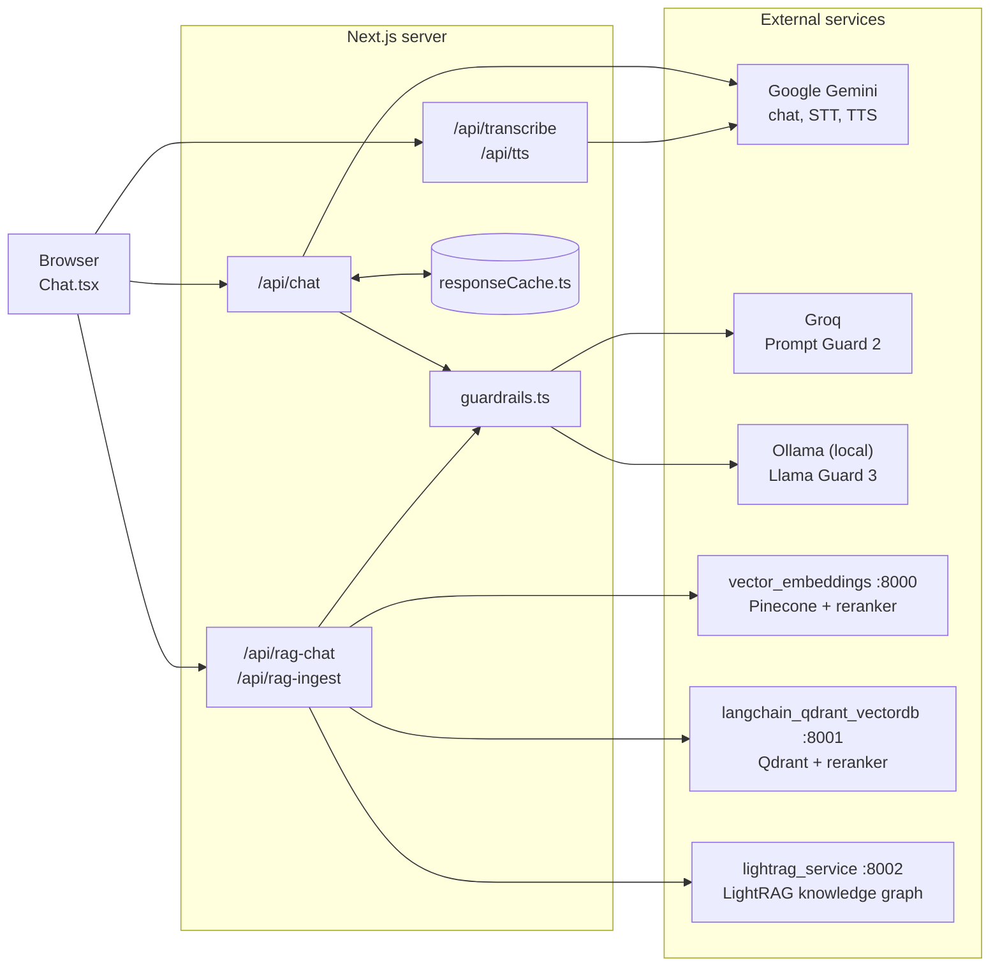
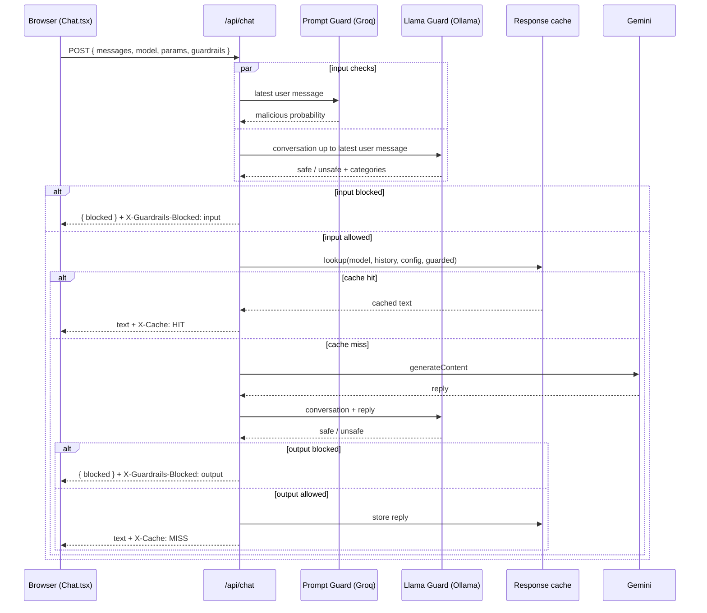

# App Architecture

A Next.js App Router app with one interactive client component (`Chat.tsx`)
and several server-only route handlers. The route handlers call Google Gemini
directly, call three external Python services for Document Q&A (two vector
databases and a LightRAG knowledge graph), and run guardrail checks through
Groq (Prompt Guard) and a local Ollama server (Llama Guard).

The editable Draw.io source of the system diagram is
[ARCHITECTURE.drawio](./ARCHITECTURE.drawio). [MODELS.md](./MODELS.md) lists
every model behind these components and what each one is for.

## System diagram

The main request paths. The `.drawio` file has the complete picture,
including feedback, the dev-only cache viewer, and the RAG backends'
own dependencies.

## Chat request with guardrails and cache

With guardrails off, the input and output checks are skipped, and streaming
requests are streamed straight from Gemini instead of being returned in one
piece.

## Request flows

**Chat** (`POST /api/chat`)
1. `Chat.tsx` sends the conversation (minus any blocked exchanges), the
   selected model, generation parameters, and the Guardrails flag.
2. The route runs the input guardrails, then looks up the response cache.
   The cache key covers the model, full history, normalized config, and
   whether guardrails are on.
3. On a miss it calls Gemini, runs the output guardrail, caches the reply,
   and returns it. Regenerate sends `skipCache: true`.

**Document Q&A** (`POST /api/rag-chat`)
1. `Chat.tsx` sends the conversation, the selected backend (`pinecone`,
   `qdrant`, or `lightrag`, from the Vector DB / Knowledge graph switch), and
   the Rerank and Guardrails flags. Backend URLs come from
   `app/utils/ragBackends.ts`.
2. The route runs the input guardrails, then forwards `{ messages, rerank }`
   to the selected backend's `POST /chat`.
3. **Vector DB:** the backend retrieves 20 candidate chunks, reranks them,
   keeps the top 5 (Pinecone) or 8 (Qdrant), and generates an answer with
   OpenAI. It returns the answer and the sources in rank order, with rerank
   scores.
   **Knowledge graph:** LightRAG extracts keywords from the question, finds
   matching entities (local) and relationships (global) in its graph, gathers
   their source chunks, and generates an answer with OpenAI, using earlier
   turns as conversation history. It returns the answer with page citations
   and the cited pages as sources.
4. The route runs the output guardrail and returns the answer. `Chat.tsx`
   appends the sources line. These answers aren't cached.

**PDF upload** (`POST /api/rag-ingest`): proxies the file to the selected
backend's `POST /ingest`. Pinecone and Qdrant chunk, embed, and upsert it
before responding. LightRAG responds immediately with a `track_id` and builds
the graph in the background (an LLM extraction call per chunk); `Chat.tsx`
polls `GET /api/rag-ingest?vector_store=lightrag&track_id=...` every 5s to
show progress.

**Voice input** (`POST /api/transcribe`): the browser records with
`MediaRecorder`; the route sends the audio to `gemini-3.6-flash` and returns
the transcript, which fills the input box. The text then goes through the
normal Chat or Document Q&A flow, guardrails included.

**Read-aloud** (`POST /api/tts`): sends a reply's text to
`gemini-3.8-flash-tts` and returns WAV audio for the browser to play.

## Key boundaries

- `app/components/Chat.tsx` is the only client component. All API keys stay
  in server-side route handlers.
- Retrieval, reranking, and graph building for Document Q&A happen in the
  Python backends, not in this app. Guardrails and caching happen in this app.
- The response cache lives in the Next.js server's memory. It's cleared on
  restart and not shared between instances.
- Guardrails fail open by default: if Groq or Ollama can't be reached, the
  request continues and the response carries `X-Guardrails: degraded`.
- `/api/cache` and `/dev/cache` return 404 outside development.

## Main files

- `app/page.tsx` — entry point for `/`
- `app/layout.tsx` — root HTML shell and metadata
- `app/components/Chat.tsx` — chat UI
- `app/components/ModelSettingsPanel.tsx` — generation parameters panel
- `app/api/chat/route.ts` — Gemini chat, with guardrails and caching
- `app/api/rag-chat/route.ts` — Document Q&A proxy, with guardrails
- `app/api/rag-ingest/route.ts` — PDF upload proxy and LightRAG ingest progress
- `app/api/transcribe/route.ts` — speech-to-text
- `app/api/tts/route.ts` — text-to-speech
- `app/api/feedback/route.ts` — feedback logging to CSV
- `app/api/cache/route.ts`, `app/dev/cache/` — development-only cache viewer
- `app/utils/ragBackends.ts` — Document Q&A backend list and URL settings
- `app/utils/guardrails.ts` — Prompt Guard and Llama Guard checks
- `app/utils/responseCache.ts` — in-memory LRU cache
